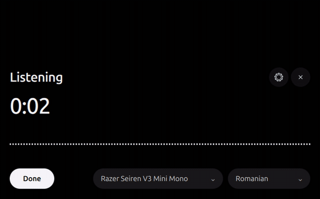

# Silisten

Push-to-talk transcription for Linux. A notch appears at the bottom of the screen, you talk, and your words come back as text with the speakers labelled.

Everything runs on your machine. Whisper does the speech recognition, Silero VAD stops silence from turning into invented sentences, and sherpa-onnx works out who was speaking.



## Using it

Press `Ctrl+Delete`, talk, press `Done`. The text lands in the notch and you copy it. If you keep talking before copying, the new text is appended instead of replacing what is there.

You can also drop an audio or video file on it, or pick one with the file button.

## Install

### AppImage

Download `Silisten-*-x86_64.AppImage` from [releases](../../releases), then:

```sh
chmod +x Silisten-*-x86_64.AppImage
./Silisten-*-x86_64.AppImage
```

The first start creates a Python environment in `~/.local/share/silisten/venv`, installs the backend, and downloads the speech model you pick. Expect a few minutes and a few GB.

### From source

```sh
git clone https://github.com/<you>/silisten
cd silisten
./install.sh
```

`install.sh` asks which model profile you want, downloads only those models, builds the Qt UI, puts `silisten` on your PATH, and registers a desktop shortcut.

Dependencies, Debian/Ubuntu names:

```
python3-venv ffmpeg alsa-utils cmake g++ \
qt6-base-dev qt6-declarative-dev qt6-wayland liblayershellqtinterface-dev
```

## Models

No model is bundled. You pick what gets downloaded, now or later.

```sh
silisten models                 # what is installed, what is in use
silisten models install speech large-v3-turbo
silisten models profile fast    # switch everything at once
```

| Model | Size | Notes |
| --- | --- | --- |
| `large-v3` | 3.1 GB | Most accurate. Wants about 6 GB of VRAM. |
| `large-v3-turbo` | 1.6 GB | Roughly twice as fast, slightly less accurate. |
| `medium` | 1.5 GB | For smaller GPUs. |
| `small` | 0.5 GB | Runs on CPU. |

A Romanian fine-tune (`fra-piz-turbo`) is used automatically when the language is set to Romanian. If its output does not look like Romanian it falls back to the main model, so a wrong language setting cannot corrupt your text.

The same choice is available in the app's settings panel. A model that is not downloaded yet is fetched in the background the first time it is needed.

## Configuration

Lives in `~/.config/silisten/config.json`, and everything below can be set with `silisten config --set key=value`.

| Key | Default | What it does |
| --- | --- | --- |
| `shortcut` | `Ctrl+Delete` | Shortcut registered with your desktop |
| `language` | `null` | Recognition language. `null` auto-detects |
| `input_device` | `default` | Microphone, by the name shown in the picker |
| `speech_model` | `large-v3` | One of the names in the table above |
| `romanian_model` | `fra-piz-turbo` | Set to `null` to disable the Romanian model |
| `diarization` | `pyannote-campplus` | Speaker labels. `null` turns them off |
| `diarization_threshold` | `0.7` | Higher merges similar voices, lower splits them |
| `vad_threshold` | `0.5` | Higher is stricter about what counts as speech |
| `auto_stop` | `false` | Stop recording by itself after a pause |
| `auto_stop_seconds` | `1.6` | How long that pause has to be |
| `auto_download` | `true` | Fetch missing models automatically |
| `models_dir` | `~/.local/share/silisten/models` | Where models are kept |
| `port` | `8756` | Local backend port |

## Requirements

- Linux with a PipeWire or ALSA microphone
- Python 3.11 or newer
- 4 GB of RAM, plus whatever your chosen model needs
- A GPU is optional but much faster. AMD is tested on ROCm; NVIDIA works through the same PyTorch path

The windowing backend is picked at startup. Compositors that support layer-shell (KDE Plasma, Hyprland, sway, river, labwc, Wayfire) get a real bottom-edge overlay. Everything else, GNOME included, gets a frameless always-on-top window in the same place.

## Troubleshooting

**The shortcut does nothing.** Run `silisten config` and check the binding matches what your desktop has. On GNOME you can rebind it under Settings → Keyboard.

**It is bound but nothing opens.** Run `silisten start` in a terminal; the error will be there.

**Transcription is slow.** You are probably running on CPU. Pick a smaller model with `silisten models profile fast`.

**Everything sounds like English.** Set the language explicitly. Auto-detect is unreliable on short clips.

**No speaker labels.** The two small ONNX models are missing: `silisten models install diarization pyannote-campplus`.

**It writes text when I said nothing.** Raise `vad_threshold`, or check the right microphone is selected.

## Building

```sh
cmake -S ui-qt -B ui-qt/build -DCMAKE_BUILD_TYPE=Release
cmake --build ui-qt/build -j"$(nproc)"
```

Pushing a tag builds the AppImage and a source archive in GitHub Actions and attaches them to the release.

## License

MIT
